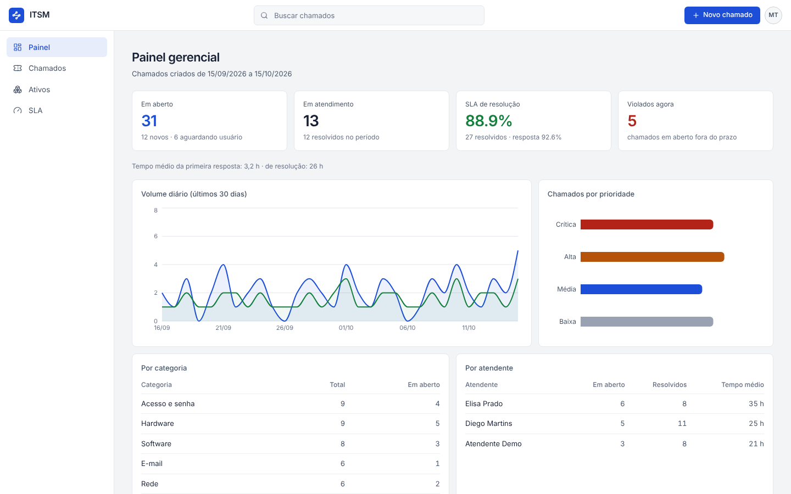
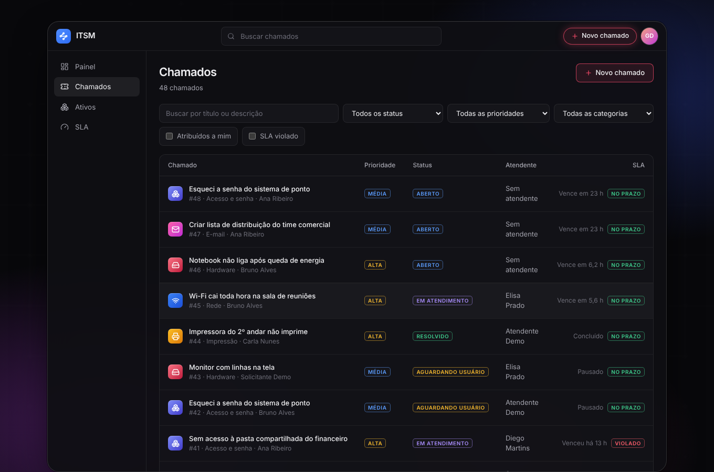
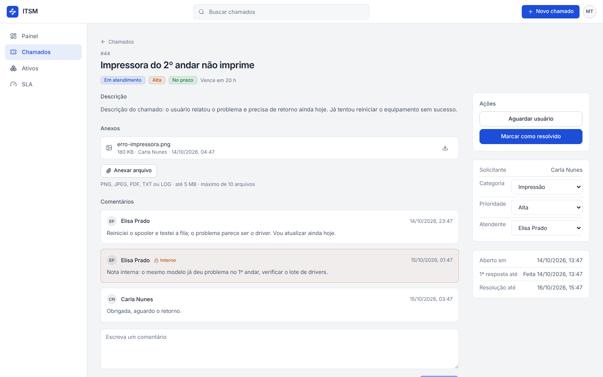
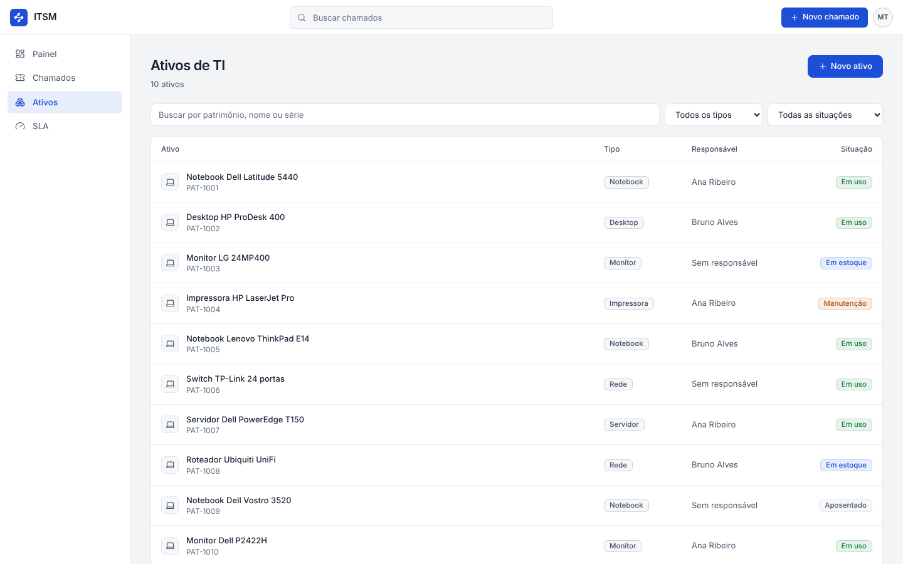
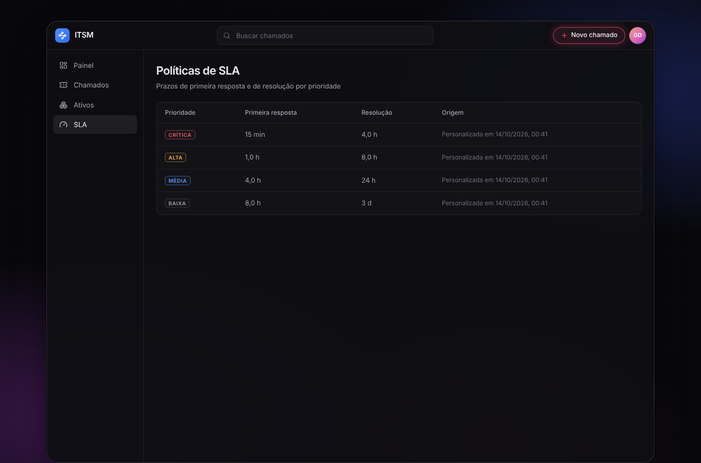
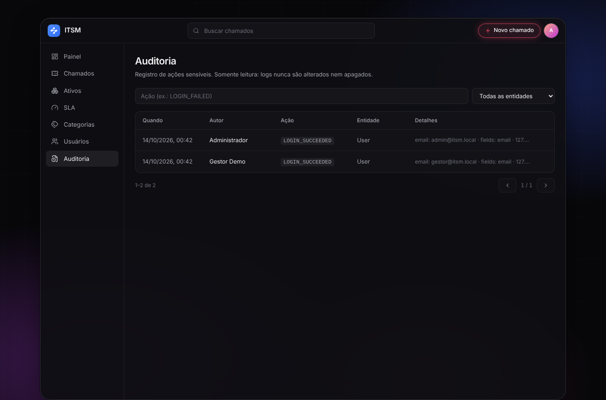

# ITSM: Sistema de Gestão de Chamados e Ativos de TI

[](https://github.com/MatheusAnsel/ITSM/actions/workflows/ci.yml)

Sistema web para registrar, acompanhar e resolver chamados de suporte de TI, controlar o parque de equipamentos e medir o atendimento por SLA, com painel gerencial e trilha de auditoria. É um projeto completo de ponta a ponta: API, banco, interface, testes automatizados, contêineres, pipeline de CI e publicação.

## Demonstração online

**Acesse: https://itsm-demo-six.vercel.app**

Não precisa instalar nem cadastrar nada: a tela de login tem botões "Entrar como Gestor / Atendente / Solicitante". A demonstração já vem com 48 chamados em todos os status, ativos, categorias e políticas de SLA.

| Perfil | E-mail | Senha | O que dá para ver |
|---|---|---|---|
| Gestor | `gestor@itsm.local` | `Demo-Itsm-2026` | Painel gerencial, SLA, ativos, usuários e auditoria |
| Atendente | `atendente@itsm.local` | `Demo-Itsm-2026` | Fila, atribuição, comentários internos, mudança de status |
| Solicitante | `solicitante@itsm.local` | `Demo-Itsm-2026` | Abertura de chamado e acompanhamento do próprio atendimento |

**Roteiro de 3 minutos:** entre como solicitante e abra um chamado com um anexo; saia e entre como atendente para assumir o chamado, deixar uma nota interna e um comentário público e resolver; por fim, entre como gestor e veja o painel, o SLA e o log de auditoria. O solicitante nunca vê a nota interna.

Avisos da hospedagem gratuita:

- A API dorme após cerca de 15 minutos sem uso. Se a primeira tentativa de login falhar, aguarde cerca de um minuto e tente de novo.
- Anexos enviados não são guardados de forma permanente.
- Os dados são fictícios e a senha acima é pública de propósito. Não cadastre informações reais.

## Telas

| | |
|---|---|
|  |  |
| Painel gerencial: SLA, volume, prioridade, categoria e carga por atendente | Fila de chamados com filtros, busca e indicador de SLA |
|  |  |
| Chamado: anexos, comentários públicos e internos, histórico e prazos | Parque de ativos com situação e responsável |
|  |  |
| Políticas de SLA por prioridade | Log de auditoria, somente para administrador |

## O que o sistema faz

- **Chamados:** abertura, fila com filtros e busca, atribuição, comentários públicos e internos, anexos, histórico completo e fluxo de status com regras (aberto, em atendimento, aguardando usuário, resolvido, fechado, cancelado).
- **SLA:** prazo de primeira resposta e de resolução por prioridade, com pausa enquanto o chamado aguarda o usuário, recálculo ao mudar a prioridade e indicador de violação.
- **Ativos de TI:** cadastro com patrimônio único, situação, responsável e chamados vinculados.
- **Painel gerencial:** chamados em aberto, cumprimento de SLA, tempos médios, volume diário, categorias e carga por atendente.
- **Perfis:** solicitante, atendente, gestor e administrador, cada um vendo e fazendo só o que lhe cabe.
- **Auditoria:** quem fez o quê, quando e de onde, sem gravar valores sensíveis.

## Decisões técnicas que valem uma conversa

- **Sessão segura:** token de acesso de 15 minutos mantido só em memória e refresh token rotativo em cookie `httpOnly` e `SameSite=Strict`, restrito ao caminho `/api/auth`. O refresh é guardado como hash, e o reuso de um token já usado derruba todas as sessões do usuário.
- **Regras de negócio isoladas:** transições de status, cálculo e pausa de SLA, visibilidade e validação de anexos ficam em funções puras (`*.rules.ts`), testáveis sem banco. O acesso a dados fica atrás de repositórios, com implementação Prisma em produção e em memória nos testes.
- **Isolamento entre usuários:** o solicitante só enxerga os próprios chamados, e a API responde 404, não 403, para os de outras pessoas, para não revelar que existem.
- **Anexos:** o tipo é validado pelos bytes do arquivo (PNG, JPEG, PDF, TXT e LOG), não pela extensão; o nome em disco é aleatório; o download só acontece por rota autenticada, sempre como `attachment` e sem cache.
- **Concorrência:** a edição de chamado usa trava otimista, e duas pessoas alterando o mesmo chamado recebem um 409 em vez de sobrescrever uma à outra.
- **Fechamento automático:** uma rotina periódica fecha chamados resolvidos sem resposta do solicitante, registrando o histórico em nome de um usuário de sistema.
- **Auditoria sem vazamento:** o interceptor grava autor, ação, entidade, IP e os nomes dos campos alterados, nunca os valores nem campos de senha ou token.
- **Configuração que falha cedo:** as variáveis de ambiente são validadas na inicialização, e em produção a API recusa subir sem HTTPS, cookie seguro e segredos adequados.

## Stack

| Camada | Tecnologias |
|---|---|
| Frontend | Next.js 16, React 19, TypeScript, Tailwind CSS 4, Recharts |
| API | NestJS 12, TypeScript, class-validator, Zod, Helmet, rate limiting, Swagger |
| Dados | PostgreSQL 16, Prisma, migrations versionadas |
| Qualidade | Jest, Supertest, ESLint, `tsc --noEmit` |
| Infra | Docker multi-stage, Docker Compose, GitHub Actions |
| Hospedagem | Vercel (site), Render (API e banco) |

## Qualidade e verificação

- Mais de 190 testes unitários e de serviço, e 27 testes de ponta a ponta contra um PostgreSQL 16 real, cobrindo autenticação e rotação de refresh, perfis, ciclo completo do chamado, pausa de SLA, comentários internos, anexos, ativos, painel e auditoria.
- O pipeline do GitHub Actions roda tipos, lint, testes, migrations, e2e, build e `npm audit` na API e no web, e constrói as duas imagens Docker a cada push.
- O fluxo da interface também foi percorrido em um navegador real, sem erros de console nem de rede.

## Como rodar

Pré-requisitos: Node.js 24.9 ou superior, Docker e Docker Compose.

**Tudo em contêineres**

```bash
git clone https://github.com/MatheusAnsel/ITSM.git
cd ITSM
cp .env.example .env
# preencha JWT_ACCESS_SECRET (openssl rand -base64 48), POSTGRES_PASSWORD (letras e números)
# e SEED_ADMIN_PASSWORD (mínimo de 10 caracteres); para dados de exemplo use SEED_DEMO=true e SEED_ON_START=true
docker compose up --build
```

Site em http://localhost:3000, API em http://localhost:3001/api e Swagger em http://localhost:3001/api/docs.

**Desenvolvimento local**

```bash
cp .env.example .env
docker compose up -d postgres   # só o banco
npm install
npm run db:migrate              # aplica as migrations
npm run db:seed                 # categorias, SLA, administrador (e demonstração com SEED_DEMO=true)
npm run dev:api                 # http://localhost:3001
npm run dev:web                 # http://localhost:3000
```

Testes: `npm test` (unitários), `npm run test:e2e` (exige um banco com as migrations aplicadas), `npm run typecheck` e `npm run lint`.

## Estrutura

```
ITSM/
├── apps/
│   ├── api/        NestJS: módulos auth, users, tickets, attachments, assets,
│   │               categories, sla, dashboard, audit e health; prisma/ e test/ (e2e)
│   └── web/        Next.js (App Router): telas, componentes e cliente da API
├── docs/           especificação técnica, guia de publicação e capturas de tela
├── docker-compose.yml
├── render.yaml     blueprint da API no Render
└── .github/workflows/ci.yml
```

## Documentação

- [Especificação técnica](docs/ESPECIFICACAO.md): escopo, perfis, requisitos, regras de negócio, fluxos, modelo de dados, API, segurança, testes e decisões em aberto.
- [Publicação em modo demonstração](docs/DEPLOY.md): como a demo foi colocada no ar e as limitações do plano gratuito.
- Swagger da API em `/api/docs` quando `SWAGGER_ENABLED=true`.

## Limitações conhecidas

- Sem verificação de e-mail no cadastro, sem autenticação em dois fatores e sem bloqueio de conta por tentativas (há apenas limite de requisições).
- SLA em tempo corrido, sem horário comercial nem feriados.
- Sem notificações por e-mail.
- Conflito de serialização na criação concorrente de anexos não tem nova tentativa automática; é raro e resulta em erro 500.

## Autor

Matheus Ansel, desenvolvedor full stack. [LinkedIn](https://linkedin.com/in/matheusansel) · [GitHub](https://github.com/MatheusAnsel) · [Portfólio](https://matheusansel-dev.vercel.app)

Licença MIT (arquivo `LICENSE`).
